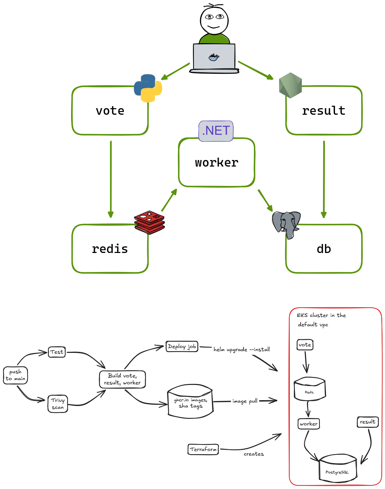

# Capstone 1: Ship It (Voting App)

A fork of `dockersamples/example-voting-app`, taken from code to an automated pipeline and a Kubernetes cluster that is built from code.

## The app

| Service | Role | Stack |
|---|---|---|
| `vote` | Page where you cast a vote | Python |
| `result` | Page showing live totals | Node.js |
| `worker` | Moves votes from Redis into Postgres | .NET |
| Redis | Queue where votes wait | |
| PostgreSQL | Permanent store of votes | |

Data flow: a vote goes to Redis, the worker saves it to PostgreSQL, and `result` reads the totals.
The app identifies a voter by an ID, and a new vote from the same voter replaces the old one, so one voter always has at most one row.

## Run it locally

```
docker compose up
```

Vote at `localhost:8080`, see results at `localhost:8081`.

## Step 1: Run it locally

I ran the app with Docker Compose and followed one vote through every hop: the worker logs, then the `votes` table in PostgreSQL, then the result page.
`result` logged `relation "votes" does not exist` once at startup. That is a startup race: the worker creates the table, and `result` queried it first. It does not recur.

## Step 2: Containerize it safely

- **Pinned base images.** Every `FROM` line that names a registry image uses a tag plus a `sha256` digest, so a build always starts from the same image contents. Stage-only lines such as `FROM base AS final` inherit the pin.
- **Non-root users.** `vote` runs as `voteuser`, `result` runs as the built-in `node` user, and `worker` runs as `workeruser`. Each was checked with `whoami` inside the running container, and the `final` stage of `vote` was built and checked separately.
- **`.dockerignore`.** Each service ignores local build output and files that could hold secrets (`__pycache__` and `.env` for `vote`; `bin/`, `obj/` and `.env` for `worker`; `node_modules/` for `result`).

## Step 3: Kubernetes cluster with Terraform

The code is in `terraform/`.

- Provider: AWS, region `us-east-1`.
- The cluster runs in the account's **default VPC**, which Terraform only looks up with data sources. It does not create a VPC.
- Cluster: EKS, with one managed node group (one `m7i-flex.large` node, maximum two).
- Subnets are filtered to `us-east-1a`, `us-east-1b` and `us-east-1c`, because EKS rejected the subnet in `us-east-1e`.
- The instance type is set explicitly because the account is on the AWS free plan, which rejected the default instance type.
- An access entry gives the Terraform caller cluster admin access, so `kubectl` works after every rebuild.
- State is kept locally and is not committed.

Connect to the cluster after it is built:

```
aws eks update-kubeconfig --name capstone_eks --region us-east-1
kubectl get nodes
```

**Rebuild check.** I ran `terraform destroy` (10 resources) and then `terraform apply` (10 resources). The rebuilt cluster came up with a Ready node and no console changes. To save cost, the cluster is destroyed when not in use.

## Step 4: GitHub Actions pipeline

One workflow, `.github/workflows/pipeline.yaml`, runs on every push to `main`:

1. **Test** and **Scan** run first, in parallel.
2. **Build vote**, **Build result** and **Build worker** run only after both succeed (`needs: [test, scan]`). Each builds its image and pushes it to `ghcr.io/ebbyboyedev/capstone-voting-app-<service>`, tagged with the commit SHA (`sha-<short commit>`).
3. **Deploy** runs only after all three builds succeed. It deploys the new images to the cluster with Helm (see "Automatic deploy" below).

The original standalone build workflows were removed, because they could build and push without passing the test or the scan.
**Proof the gate works:** I changed the smoke test's expected count to make it fail. Test failed, and none of the three builds ran.

### Why the provided test was replaced

The test shipped with `result` runs in a container built on `node:8.9-slim`, which is based on Debian 8. Debian's package servers no longer carry Debian 8, so `apt-get update` returns 404 and the image cannot be built. It also depends on PhantomJS, which is discontinued.
I replaced it with `scripts/smoke-test.sh`, which checks the same thing: a vote posted to `vote` ends up counted. It:

1. waits until the `vote` page responds,
2. posts one vote,
3. waits for the vote to travel through Redis and the worker,
4. counts the rows in the `votes` table with `psql`,
5. exits `0` only if the count is exactly `1`, and exits `1` for any other number.

I confirmed it fails when it should by changing the expected count to `2` and watching the job fail.

### Security scan

Trivy scans the repository's files for vulnerabilities and fails the job on any HIGH or CRITICAL finding that has a fix available. It also uploads a JSON report as a build artifact.
The first run failed with HIGH and CRITICAL findings in `result/package-lock.json` (in `body-parser`, `engine.io`, `path-to-regexp`, `proxy-addr`, `socket.io-parser` and `ws`). I fixed them with `npm audit fix`, and the smoke test and scan passed afterwards.

**Limitation:** the scan reads project files, not the built images. The shared build workflow builds and pushes in one step, so there is no point between the two to scan an image.

### Secrets

No secrets are stored in Git.
- The pipeline pushes to GitHub Container Registry using the temporary token GitHub gives every run.
- AWS credentials live in `~/.aws` on my machine.
- Terraform state and the `.terraform/` folder are ignored by Git.
- The test database password `postgres` in `result/docker-compose.test.yml` is only for a throwaway local test database.

## Step 5: Deploy and roll back with Helm

The chart is in `helm/voting-app`. It has one `values.yaml`. Its templates are the Deployments and Services from the upstream `k8s-specifications` folder (`vote`, `result`, `worker`, Redis and Postgres), and the three app images are now filled in from `values.yaml` (a repository and a tag each), so they point at my own images on `ghcr.io` and not at the upstream author's.
The three packages on `ghcr.io` are public, so the cluster can pull them without credentials.

Install it (with the cluster running and `kubectl` connected):

```
helm install voting-app ./helm/voting-app
kubectl get pods
```

All five pods reach `Running`. To check it end to end, I forwarded the two web pages to my laptop and cast a vote:

```
kubectl port-forward svc/vote 8090:8080
kubectl port-forward svc/result 8091:8081
```

The vote appeared on the result page.

### Rollback demo

1. In `values.yaml` I set the `vote` image tag to a value that is not a valid tag, and ran `helm upgrade voting-app .`.
2. The new `vote` pod showed `InvalidImageName` and never became ready, but the old pod kept running, because a Deployment replaces pods gradually and keeps the old one until the new one is ready.
3. `helm history voting-app` listed revision 1 as `superseded` and revision 2 as `deployed`. Helm reports that it delivered the change, not that the app is healthy, so the broken pod was only visible through `kubectl get pods`.
4. `helm rollback voting-app 1` restored revision 1. The broken pod disappeared and the original pod was still running.
5. A rollback changes only the cluster, so I restored the local file with `git checkout`.

## Automatic deploy

A `deploy` job in `pipeline.yaml` runs after the three builds:

1. It checks whether the `capstone_eks` cluster exists, using `aws eks describe-cluster`.
2. **If the cluster does not exist**, the job prints a message and ends green without deploying. This is deliberate: to protect my AWS credits I destroy the cluster whenever I am not working, so a push while it is down still tests, scans, builds and pushes images.
3. It skips only when AWS answers `ResourceNotFoundException`. Any other error, such as bad credentials, fails the job.
4. **If the cluster exists**, the job connects with `aws eks update-kubeconfig` and runs `helm upgrade --install voting-app ./helm/voting-app`. It overrides the three image tags with `sha-` plus the first 7 characters of the commit being built, and uses `--wait` so a release whose pods never become ready fails the job.

**Credentials.** The job uses a separate IAM user, `github-deploy`, not my admin user:

- Its only IAM permission is `eks:DescribeCluster` on this one cluster.
- Inside the cluster, Terraform gives it an access entry with `AmazonEKSEditPolicy`, limited to the `default` namespace.
- Its access key is stored in GitHub repository secrets (`AWS_ACCESS_KEY_ID`, `AWS_SECRET_ACCESS_KEY`) and is never written to a file in the repo.

## Architecture


